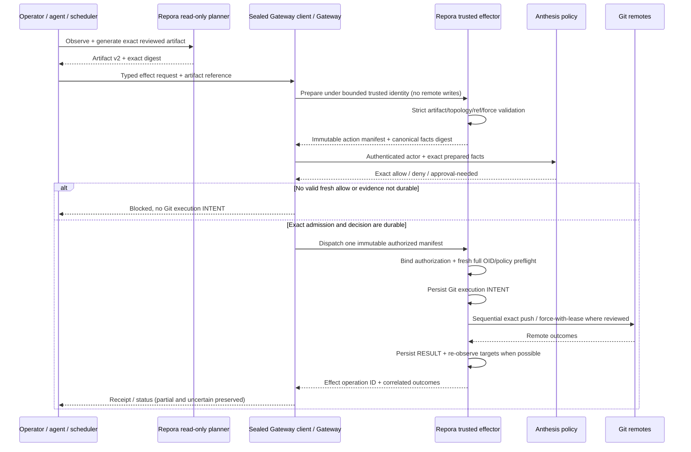

# Gateway-governed mirror reconciliation

Status: **Proposed design** under #212; **not implemented**. The Capability Gateway/Anthesis runtime is external to Repora and must be qualified independently before #213 permits real effects.
Reviewed: 2026-10-11

## Decision to be reviewed

Admit precisely one Repora effect, `repository.mirror.reconcile` (name provisional until the shared effect registry admits it), through a **sealed, authenticated Capability Gateway client**. Reuse Repora's existing mirror status/plan/apply engine as the domain effector; do not implement Git or provider-mutation logic in the Gateway.

- **Repora** owns exact topology, planning, target identity, local ref policy, destructive intent, final preflight, Git execution and immutable per-mirror execution journal.
- **Gateway** owns authenticated invocation admission, canonical request identity, idempotency/dispatch state and bounded cross-domain receipt.
- **Anthesis** owns authorization policy, approval and effect-time authority freshness. It receives only bounded exact facts; cannot edit a plan or execute Git.
- **Dubnium** owns runtime, credential isolation, trusted-front-door actor binding, provider deployment and scheduling. A repository role or a successful code merge grants no host effect authority.
- **Operator/agent** may propose/inspect exact plans without possessing provider write credentials. A privileged trusted local `repoctl` CLI remains independently available; its use must be excluded from **governed** claims unless host access controls enforce the intended split.

This composes ADR-0018's optional `pre_apply` authorization intent rather than superseding it. ADR-0018's `disabled/record_only/warn/enforce` semantics are not a substitute for authenticated effect admission. Non-enforcing modes are **for trusted standalone/observational contexts only**, never a valid untrusted automation deployment profile.

## First slice and non-goals

Only existing default-branch reconciliation plan **v2** is eligible initially. Mirror targets are the supported GitHub/GitLab/Bitbucket Cloud provider/path identities under a GitLab canonical. A gateway manifest **cannot** introduce new refs, provider provisioning, CI settings, repository creation, projection, promotion, or history rewriting.

No new `git push --mirror` behavior, arbitrary CLI/shell command, transport URL, repository script, env var, local filesystem path, or credential reference is accepted from a caller as effect parameters.

Other mutating Repora domains (managed README, CI settings, provisioning, projection, promotion) require separately named typed effects with independently reviewed authority.

## Trust and data flow



**Preparation** can refresh a Repora-owned local read cache but cannot push, change provider settings or claim effect success. This is a proposed Gateway **domain-preparation interface requirement**, not an assertion that Dubnium Gateway currently implements one. The Gateway's trusted adapter and provider must agree on how immutable prepared facts become Anthesis input **before authorization**; if that facility does not exist, it is a dependency to implement, not grounds for allowing self-declared facts from a remote caller.

Gateway-owned receipt/effect state is not a substitute for Repora's durable execution journal. After an `allow`, the provider must still verify the decision's exact manifest/facts/actor binding before action zero. The request may not smuggle a different action by rehydrating runtime Git aliases or mutable remote URLs.

## Typed request and effect binding (illustrative, not released schema)

```json
{
  "kind": "repora.io/governed-mirror-request",
  "version": 1,
  "effect": "repository.mirror.reconcile",
  "idempotency_key": "operator-generated-stable-nonce",
  "artifact": {
    "kind": "repora.io/reconciliation-plan",
    "version": 2,
    "sha256": "<sha256-of-exact-reviewed-artifact-bytes>",
    "content_reference": "<opaque-gateway-owned-content-identity>"
  },
  "intent": {
    "destructive_authorized": false
  }
}
```

This is an **input sketch only**. The final schema must align with Dubnium's shared request envelope and immutable content-addressing rules; do not create a parallel envelope if the existing one is sufficient. The caller does not submit an authoritative `actor`, `provider_url`, `credential`, `target_command`, `policy_decision` or `expected_receipt`. A local path is not an acceptable content reference for a privileged effector.

The reviewed artifact's **exact serialized bytes** must bind request digest identity; do not silently canonicalize or reserialize a modified plan after human review. Domain facts use a separately versioned **canonical** serialization and digest. Define and test canonical field ordering, duplicate-key rejection, bounded strings, Unicode normalization decision, number semantics and version negotiation in the schema implementation slice; reject unsupported versions rather than guessing compatibility. Plan v1/backward compatibility remains a standalone CLI concern until explicitly qualified for governed requests.

Trusted preparation returns at minimum:

- repository durable UID; canonical provider/path/default-branch identity; every target provider/path/ref identity and reviewed before/desired OID;
- exact artifact digest and topology/ref-policy binding; deterministic action ordering; per-action reviewed force intent and total destructive classification;
- authenticated Gateway **transport principal** and separately verified **effective actor** provenance, or a rejected request if provenance cannot be established;
- canonical facts digest, immutable plan/manifest identity and bounded risk classification;
- current policy-relevant state dependency revisions, expiry constraints and supported effect/schema version.

A request's `destructive_authorized=true` is an **explicit extra human/tool intent signal**, equivalent in meaning to the CLI's opt-in `--force`, never equivalent to reviewed force intent **by itself**. Both the reviewed plan and this explicit invocation intent must authorize the destructive class. Anthesis `allow` cannot silently supply either. A non-destructive request must reject a reviewed plan containing destructive actions. For a single multi-mirror request, use the most restrictive applicable action/target permissions; do not narrow the presented request after authorization.

## Authentication, actor delegation and custody

The Gateway's immediate authenticated transport principal may be the Operator Gateway service while the effective actor is a user/agent identified upstream. Those identities must remain distinct. A trusted-intermediary actor assertion must be bound to the verified upstream request, audience, expiry, nonce and exact submitted effect; verification is performed in the Gateway's trusted boundary, **not** based on arbitrary JSON from an agent. This depends on Dubnium's trusted-intermediary work (#1197) and shared contracts.

A remote client **never** receives the local Gateway socket or Repora canonical write credential. A sealed capability client is invoked by an already-authenticated front door. Gateway policy may narrow but may not invent a caller, role, approval or capability.

Credential scope is not established by labels in `repora.yaml`. The effector is isolated under a dedicated principal, with configured allowed repository endpoint/host identity and minimally scoped provider credentials. Validate actual token permission boundaries; if a provider token cannot be constrained to the reviewed target, document the residual authority and isolate further or block production admission. System Git/credential helpers must be made available only inside this trusted effect boundary. Environment, Git config, remotes, redirects and symlink/cache paths are not trusted merely because they were local; resolve against provider/instance and explicit transport allowlists. Do not leak credentials through URLs, subprocess arguments, stderr, journals, caches or HTTP diagnostics.

A runtime that grants the proposer general Git push ability cannot claim governed complete mediation, even if its preferred UI happens to use the Gateway.

## Effect-time freshness and mutations

1. Caller supplies exact artifact reference and explicit destructive intent.
2. Trusted Repora preparation validates all topology, policy, target identity, branch, and OID preconditions **before** presenting facts for authorization. If any required fact is unknown, no applicable prepared operation exists.
3. Gateway/Anthesis binds decision to exact prepared artifact+facts, verified principal/effective actor and fresh authorization-relevant state/expiry. In enforce mode, only a valid explicit `allow` with persisted evidence permits dispatch.
4. Immediately before action zero, the effector checks authorization validity and **all** selected repositories' mutation-critical OIDs, including every mirror in a multi-target action. A changed ref, policy/topology/identity/approval dependency or expired authority invalidates the operation. Re-observe and re-plan; never silently reauthorize the old artifact.
5. Persist Git execution INTENT before any push. Then use Repora's existing independent sequential target semantics with exact leased force updates where required. Record each target's before/desired/after/outcome and final RESULT.
6. Re-observe targets where possible and distinguish verified convergence from accepted-but-unverified mutation, stale state, partial execution and evidence failure. A provider push acknowledgement alone is not whole-repository completion.

Preflight before action zero prevents a known stale plan from partially executing. External concurrent writers can still race an otherwise valid non-forced push; the Git push's native ancestry/expected ref behavior remains another safety boundary. There is **no cross-remote transaction**, and a post-first-target failure does not retroactively cancel already completed pushes.

## Idempotency, crash/recovery and evidence

The Gateway must durably bind each idempotency key to the exact canonical request digest and trusted actor identity. Reusing a key with different request bytes or actor fails. Repeating an already dispatched request returns recorded status/evidence and **never automatically reexecutes Git**. A crash with uncertain dispatch status is `unknown`/needs reconciliation, not evidence of no side effect.

A fresh attempt after failure or partial success requires **new observation, a new exact reviewed plan and a new idempotency identity**. A previous `allow` or INTENT/RESULT cannot be replay authority. A force-with-lease target that changed after partial execution must not be overwritten using the old lease.

Evidence join requirements:

| Record | Must bind | Not allowed |
| --- | --- | --- |
| Gateway receipt | Request digest, authenticated transport principal, effective actor provenance reference, domain effect ID, admission/dispatch state | Raw tokens, caller-injected actor as authority |
| Anthesis evidence | Exact plan/facts digest, policy ID/version, decision, approval/freshness inputs, gate status | Provider credentials, mutable alias as identity |
| Repora policy-gate evidence | Reviewed artifact/facts digest, verified allow/deny, admission ID, persisted-before-INTENT ordering | Reusable allow token as a new execution grant |
| Repora execution journal | Same operation/effect correlation, exact plan, per-target INTENT/RESULT, observed OIDs/outcomes | Claims of cross-remote atomicity/rollback |

Gateway admission-evidence failure or Anthesis evaluation/policy-evidence persistence failure blocks execution. Git INTENT persistence failure blocks execution. A Git RESULT/journal failure after accepted mutation is **operational failure with potentially completed effects**, not permission to replay. Redaction applies to all evidence and error messages. Retention, audit export and external signing are separate decisions, not assumed shipped by this proposal.

## Failure and abuse conformance matrix

| Failure/abuse | Required result |
| --- | --- |
| Unauthenticated principal or forged delegated actor | Reject before trusted preparation/dispatch; no Git write |
| Missing actor provenance, wrong audience or expired delegation | Reject; no caller-body fallback |
| Altered artifact bytes, kind/version, duplicate JSON keys or mismatched digest | Reject; no reinterpretation |
| Target provider/path/instance/default branch or policy ref changed | Reject stale; no re-targeting |
| Destructive action without both reviewed force and explicit invocation flag | Reject even if Anthesis says allow |
| Anthesis deny, warn, require-approval, unreachable or timeout | Fail closed before Git INTENT/write in governed mode |
| Decision for different artifact, actor, facts or expired state | Reject; old allow never applies |
| Target OID changes after decision / before action zero | Reject stale; re-observe/re-plan |
| Git remote redirects, unexpected host, env Git config, symlink/path escape | Reject/sandbox before credentials can reach unreviewed destination |
| Git execution INTENT write fails | No remote mutation |
| First mirror succeeds, second fails, third succeeds | Partial per-target evidence, nonzero command result, no rollback |
| RESULT write fails after remote acceptance | Ambiguous/operational failure, no blind retry |
| Same idempotency key returns / gateway restarts mid-operation | Existing status or ambiguous, never second push |
| Caller uses direct provider write credentials outside gateway | Governed deployment qualification fails (bypass), regardless of test-green Gateway API |

Test against disposable **real Git** repositories and a fake authenticated Gateway/Anthesis boundary first, then an independently qualified full deployment. Inject runtime faults before/after each durable boundary; test exact serialization stability and no secret content in captured traces. Explicitly verify the no-effect Gateway fixture does **not** qualify as a production effect.

## Alternatives and consequences

- **Direct repoctl → Anthesis for all invocations:** preserves ADR-0018 for trusted CLI but does not authenticate untrusted remote actors, centralize idempotent effect admission or prevent credential bypass. Not sufficient for governed agents.
- **Gateway shells out to arbitrary `repoctl apply`/Git commands:** small initial wrapper but unacceptable argument/credential scope, target binding and bypass surface. Reject.
- **Gateway owns provider Git engine:** duplicates tested Repora reconciliation and confuses admission with domain execution. Reject.
- **Typed Gateway effect + shared Repora domain effector (proposed):** additional adapter/deployment boundary, but preserves exact planning and deterministic domain safety; independently qualified runtime prerequisite.

## Implementation slices and review questions

1. #212: accept/adjust this design and ADR-0019; explicitly resolve Gateway pre-authorization domain preparation, contract registry and trust/actor binding dependencies.
2. #213a (in #213): schema fixtures, deterministic plan/facts digest and strict request validation, transport-free evaluator fake; **no effect change**.
3. #213b: reuse Repora core through an internal trusted effector with exact prepare/apply, evidence and negative tests; **no external credentials**.
4. #213c: sealed client and Gateway provider registration in Dubnium, Anthesis enforce decision, idempotency/receipts and production principal custody; **no production activation by merge**.
5. #213d: full disposable Git E2E plus independent security review; only later explicitly authorize a controlled live pilot with evidence of complete mediation.

**Open dependencies:** the production Gateway effect-admission/dispatch contract, trusted-intermediary actor binding, effect-time Anthesis state freshness, credential-bound provider/instance configuration and operation receipt schemas must be verified against their authoritative owners. This document must not fabricate those capabilities.

## References

- #30 / `docs/decisions/0018-optional-anthesis-policy-gate.md`
- #211–213
- `docs/architecture/end-to-end-acceptance.md`
- Dubnium `docs/architecture/capability-taxonomy.md`; trust-intermediary #1197
- Anthesis effect-time authority freshness #203
